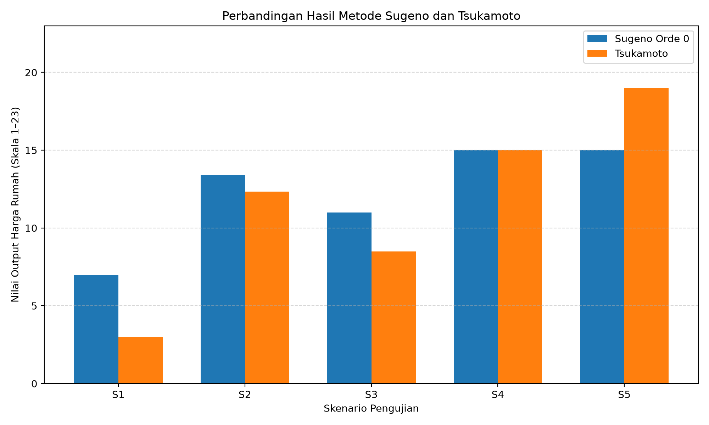

# LAPORAN PRAKTIKUM LOGIKA FUZZY

**Ruly Hajar Fauziah**
**240306034**
https://github.com/rulyhajarfauziah

Program Studi Teknologi Informasi
Fakultas Dakwah dan Ilmu Komunikasi
Universitas Islam Negeri Mataram
2026

---

| | |
|---|---|
| **Modul** | Modul 2 |
| **Topik** | Metode Sugeno dan Tsukamoto |
| **Repository** | https://github.com/rulyhajarfauziah |
| **Tanggal** | 24 Oktober 2026 |

---

## A. Tujuan

Setelah menyelesaikan praktikum ini, mahasiswa diharapkan mampu:

1. Memahami prinsip kerja metode inferensi Takagi-Sugeno-Kang (TSK / Sugeno) orde 0 dan orde 1.
2. Memahami prinsip kerja metode inferensi Tsukamoto yang menggunakan fungsi keanggotaan monotonik.
3. Melakukan perhitungan manual untuk proses inferensi Sugeno dan Tsukamoto menggunakan teknik rata-rata terbobot (Weighted Average).
4. Mengimplementasikan algoritma Sugeno dan Tsukamoto secara modular menggunakan bahasa pemrograman Python.
5. Membandingkan karakteristik, akurasi, efisiensi komputasi, dan pemilihan metode antara Mamdani, Sugeno, dan Tsukamoto.

## B. Requirement

1. Sistem Operasi yang digunakan: Windows 11 Home Single Language 64-bit (10.0, Build 26100)
2. Browser: Google Chrome Version 130.0.6723.117 (Official Build) (64-bit)
3. Tools yang digunakan: Visual Studio Code

## C. Dasar Teori

### 1. Metode Sugeno (Takagi-Sugeno-Kang)

Diperkenalkan oleh Takagi, Sugeno, dan Kang (1985). Pada metode Sugeno, konsekuen aturan bukanlah himpunan fuzzy, melainkan persamaan matematika tegas (crisp).

**a. Sugeno Orde 0 (Konstanta)**

Konsekuen berbentuk nilai konstanta skalar:

$$\text{Rule } i: \text{IF } x \text{ is } A_i \text{ AND } y \text{ is } B_i \text{ THEN } z_i = k_i$$

**b. Sugeno Orde 1 (Fungsi Linear)**

Konsekuen merupakan kombinasi linear dari variabel-variabel input:

$$\text{Rule } i: \text{IF } x \text{ is } A_i \text{ AND } y \text{ is } B_i \text{ THEN } z_i = p_i x + q_i y + r_i$$

**Defuzzifikasi Sugeno: Rata-Rata Terbobot (Weighted Average)**

Karena setiap aturan menghasilkan nilai tegas z_i, proses defuzzifikasi tidak memerlukan integrasi kurva yang rumit:

$$z^* = \frac{\sum_{i=1}^{N} \alpha_i \cdot z_i}{\sum_{i=1}^{N} \alpha_i}$$

### 2. Metode Tsukamoto

Pada metode Tsukamoto, setiap aturan memiliki konsekuen berupa himpunan fuzzy yang fungsi keanggotaannya harus monoton tegas (selalu naik atau selalu turun).

```
        Kurva Monoton Naik                 Kurva Monoton Turun

μ(z)                                μ(z)
1.0 ──────────────┐                 1.0 ──────┐
                 /│                       │\  │
                / │                       │ \ │
α ──────────●    │                 α ─────┼──●
           /│     │                       │ /│
0.0 ─────────┴─┼──┴──────── z       0.0 ───┴─┼┴──────── z
             a  z*  b                       a  z*  b

   z* = a + α(b − a)                   z* = b − α(b − a)
```

Untuk setiap aturan i:

1. Hitung α_i dari premis antecedent.
2. Cari nilai tegas z_i secara langsung menggunakan fungsi invers keanggotaan: z_i = μ⁻¹(α_i).
3. Defuzzifikasi akhir dihitung dengan rata-rata terbobot:

$$z^* = \frac{\sum_{i=1}^{N} \alpha_i \cdot z_i}{\sum_{i=1}^{N} \alpha_i}$$

## D. Contoh Perhitungan Manual

**Studi Kasus: Penentuan Harga Rumah**

- Input 1: Lokasi Rumah (x = 15)
- Input 2: Luas Tanah (y = 120 m²)
- Input 3: Luas Bangunan (w = 80 m²)
- Output: Harga Rumah (skala 1 – 23)

**Fuzzifikasi:**

Berdasarkan parameter fungsi keanggotaan yang digunakan:

- Lokasi:
  - Sangat Strategis = 0,5
  - Strategis = 0,333
- Luas Tanah:
  - Sedang = 1
- Luas Bangunan:
  - Sedang = 1

**Aturan yang aktif:**

Berdasarkan tabel aturan harga rumah:

- **R05**: IF Lokasi Sangat Strategis AND Luas Tanah Sedang AND Luas Bangunan Sedang THEN Harga Rumah Mahal.

  α₁ = min(0,5; 1; 1) = 0,5

- **R14**: IF Lokasi Strategis AND Luas Tanah Sedang AND Luas Bangunan Sedang THEN Harga Rumah Normal.

  α₂ = min(0,333; 1; 1) = 0,333

### 1. Perhitungan Sugeno Orde 0

Pada Sugeno orde 0, setiap aturan menghasilkan nilai konstanta. Digunakan nilai puncak fungsi keanggotaan harga rumah sebagai nilai konstanta:

- R05: Harga Mahal = 15
- R14: Harga Normal = 11

Diketahui:

- z₁ = 15
- z₂ = 11

Menggunakan rumus rata-rata terbobot:

$$z^* = \frac{\sum \alpha_i z_i}{\sum \alpha_i}$$

$$z^* = \frac{(0{,}5 \times 15) + (0{,}333 \times 11)}{0{,}5 + 0{,}333}$$

$$z^* = \frac{7{,}5 + 3{,}663}{0{,}833}$$

$$z^* = 13{,}415$$

Jadi, hasil perhitungan Sugeno orde 0 adalah sekitar 13,415 pada skala harga rumah.

### 2. Perhitungan Tsukamoto

Pada metode Tsukamoto, konsekuen harus menggunakan fungsi keanggotaan monoton.

Untuk contoh perhitungan ini, digunakan fungsi monoton naik dengan rentang output harga rumah 1–23.

Rumus:

$$z_i = 1 + \alpha_i (23 - 1)$$

$$z_i = 1 + 22\alpha_i$$

Perhitungan setiap aturan:

- R05:

  z₁ = 1 + 22(0,5) = 12

- R14:

  z₂ = 1 + 22(0,333) = 8,326

Selanjutnya, menghitung hasil akhir menggunakan rata-rata terbobot:

$$z^* = \frac{(0{,}5 \times 12) + (0{,}333 \times 8{,}326)}{0{,}5 + 0{,}333}$$

$$z^* = \frac{6 + 2{,}7716}{0{,}833}$$

$$z^* \approx 10{,}530$$

Jadi, hasil perhitungan Tsukamoto adalah sekitar 10,530 pada skala harga rumah.

## E. Implementasi

```python
import numpy as np

# ==========================================================
# 1. IMPLEMENTASI SISTEM SUGENO (ORDE 0 DAN ORDE 1)
# ==========================================================
def hitung_sugeno(alphas, z_values):
    """
    alphas: list firing strength [alpha_1, alpha_2, ...]
    z_values: list output tegas aturan [z_1, z_2, ...]
    """
    alphas = np.array(alphas)
    z_values = np.array(z_values)

    total_alpha = np.sum(alphas)

    if total_alpha == 0:
        return 0.0

    return np.sum(alphas * z_values) / total_alpha


# ==========================================================
# 2. IMPLEMENTASI SISTEM TSUKAMOTO
# ==========================================================
def invers_monoton_naik(alpha, a, b):
    """z = a + alpha * (b - a)"""
    return a + alpha * (b - a)


def invers_monoton_turun(alpha, a, b):
    """z = b - alpha * (b - a)"""
    return b - alpha * (b - a)


def hitung_tsukamoto(alphas, fungsi_invers_list):
    """
    fungsi_invers_list: list lambda fungsi invers untuk setiap aturan
    """
    z_values = [
        func(alpha)
        for alpha, func in zip(alphas, fungsi_invers_list)
    ]

    return hitung_sugeno(alphas, z_values), z_values


# ==========================================================
# 3. PENGUJIAN DAN KOMPARASI KASUS HARGA RUMAH
# ==========================================================
# Input crisp berdasarkan contoh perhitungan manual
lokasi = 15
luas_tanah = 120
luas_bangunan = 80

# Nilai alpha berdasarkan hasil fuzzifikasi
# R05 = Sangat Strategis AND Sedang AND Sedang
# R14 = Strategis AND Sedang AND Sedang
alphas_kasus = [0.5, 0.333]

# A. SUGENO ORDE 0
# R05: Harga Mahal = 15
# R14: Harga Normal = 11
z_sugeno0 = [15.0, 11.0]

hasil_sugeno0 = hitung_sugeno(
    alphas_kasus,
    z_sugeno0
)

# B. SUGENO ORDE 1
# Konsekuen berupa persamaan linear.
# Koefisien berikut merupakan contoh rancangan.

# R05
z1 = (
    0.05 * lokasi +
    0.03 * luas_tanah +
    0.04 * luas_bangunan +
    5
)

# R14
z2 = (
    0.04 * lokasi +
    0.02 * luas_tanah +
    0.03 * luas_bangunan +
    4
)

z_sugeno1 = [z1, z2]

hasil_sugeno1 = hitung_sugeno(
    alphas_kasus,
    z_sugeno1
)

# C. TSUKAMOTO
# Menggunakan fungsi monoton naik dengan rentang 1-23
fungsi_tsukamoto = [
    lambda a: invers_monoton_naik(a, 1.0, 23.0),
    lambda a: invers_monoton_naik(a, 1.0, 23.0)
]

hasil_tsukamoto, z_tsuka_values = hitung_tsukamoto(
    alphas_kasus,
    fungsi_tsukamoto
)

# ==========================================================
# 4. CETAK HASIL
# ==========================================================
print("=" * 65)
print("HASIL KOMPARASI METODE SUGENO DAN TSUKAMOTO")
print("SISTEM PENENTUAN HARGA RUMAH")
print("=" * 65)

print("\nINPUT CRISP")
print(f"Lokasi        : {lokasi}")
print(f"Luas Tanah    : {luas_tanah} m2")
print(f"Luas Bangunan : {luas_bangunan} m2")

print("\nFIRING STRENGTH")
print(f"Alpha R05 : {alphas_kasus[0]:.3f}")
print(f"Alpha R14 : {alphas_kasus[1]:.3f}")

print("\nA. SUGENO ORDE 0")
print(f"z1 (R05) : {z_sugeno0[0]:.3f}")
print(f"z2 (R14) : {z_sugeno0[1]:.3f}")
print(f"Hasil    : {hasil_sugeno0:.3f}")

print("\nB. SUGENO ORDE 1")
print(f"z1 (R05) : {z_sugeno1[0]:.3f}")
print(f"z2 (R14) : {z_sugeno1[1]:.3f}")
print(f"Hasil    : {hasil_sugeno1:.3f}")

print("\nC. TSUKAMOTO")
print(f"z1 (R05) : {z_tsuka_values[0]:.3f}")
print(f"z2 (R14) : {z_tsuka_values[1]:.3f}")
print(f"Hasil    : {hasil_tsukamoto:.3f}")

print("=" * 65)
print("Output menggunakan skala harga rumah 1-23.")
print("=" * 65)
```

**Output:**

```
=================================================================
HASIL KOMPARASI METODE SUGENO DAN TSUKAMOTO
SISTEM PENENTUAN HARGA RUMAH
=================================================================

INPUT CRISP
Lokasi        : 15
Luas Tanah    : 120 m2
Luas Bangunan : 80 m2

FIRING STRENGTH
Alpha R05 : 0.500
Alpha R14 : 0.333

A. SUGENO ORDE 0
z1 (R05) : 15.000
z2 (R14) : 11.000
Hasil    : 13.401

B. SUGENO ORDE 1
z1 (R05) : 12.550
z2 (R14) : 9.400
Hasil    : 11.291

C. TSUKAMOTO
z1 (R05) : 12.000
z2 (R14) : 8.326
Hasil    : 10.531
=================================================================
Output menggunakan skala harga rumah 1-23.
=================================================================
```

## F. Matriks Perbandingan: Mamdani vs Sugeno vs Tsukamoto

| Kriteria Komparasi | Metode Mamdani | Metode Sugeno (TSK) | Metode Tsukamoto |
|---|---|---|---|
| **Bentuk Konsekuen** | Himpunan fuzzy berupa kategori harga rumah (Sangat Murah, Murah, Normal, Mahal, Sangat Mahal). | Konstanta (Orde 0) atau fungsi linear (Orde 1) sebagai nilai keluaran harga rumah. | Himpunan fuzzy dengan fungsi keanggotaan yang monoton. |
| **Kecepatan Komputasi** | Relatif lebih lambat karena memerlukan proses agregasi dan defuzzifikasi. | Sangat cepat karena menggunakan perhitungan rata-rata terbobot. | Relatif cepat karena menggunakan fungsi invers dan rata-rata terbobot. |
| **Representasi Penalaran** | Alami dan mudah dipahami karena menggunakan kategori harga rumah. | Kurang intuitif untuk bahasa manusia karena konsekuennya berupa nilai atau persamaan. | Cukup mudah dipahami, tetapi konsekuennya harus memiliki fungsi keanggotaan monoton. |
| **Cocok untuk** | Sistem pendukung keputusan yang menentukan kategori harga rumah berdasarkan kondisi rumah. | Sistem prediksi harga rumah yang membutuhkan hasil berupa nilai numerik. | Sistem penentuan harga rumah yang memiliki hubungan keputusan monoton. |
| **Optimasi Matematika** | Relatif sulit diintegrasikan dengan metode pembelajaran mesin karena proses defuzzifikasi. | Mudah dikombinasikan dengan Neural Network, misalnya ANFIS. | Relatif lebih sulit dioptimasi karena membutuhkan fungsi keanggotaan monoton dan perhitungan invers. |

## G. Tugas Praktikum 9

```python
import numpy as np
import matplotlib.pyplot as plt

# ==========================================================
# 1. FUNGSI KEANGGOTAAN
# ==========================================================
def trapmf(x, a, b, c, d):
    if x < a or x > d:
        return 0.0
    elif b <= x <= c:
        return 1.0
    elif a <= x < b:
        return (x - a) / (b - a) if b != a else 1.0
    else:
        return (d - x) / (d - c) if d != c else 1.0


def trimf(x, a, b, c):
    if x < a or x > c:
        return 0.0
    elif x == b:
        return 1.0
    elif x < b:
        return (x - a) / (b - a)
    else:
        return (c - x) / (c - b)


# ==========================================================
# 2. IMPLEMENTASI SUGENO ORDE 0
# ==========================================================
def hitung_sugeno(alphas, z_values):
    total_alpha = np.sum(alphas)

    if total_alpha == 0:
        return None

    return np.sum(np.array(alphas) * np.array(z_values)) / total_alpha


# ==========================================================
# 3. IMPLEMENTASI TSUKAMOTO
# ==========================================================
def invers_monoton_naik(alpha, a, b):
    return a + alpha * (b - a)


def invers_monoton_turun(alpha, a, b):
    return b - alpha * (b - a)


def hitung_tsukamoto(alphas, z_values):
    total_alpha = np.sum(alphas)

    if total_alpha == 0:
        return None

    return np.sum(np.array(alphas) * np.array(z_values)) / total_alpha


# ==========================================================
# 4. FUNGSI MENGHITUNG ALPHA 4 ATURAN
# ==========================================================
def hitung_alpha(lokasi, tanah, bangunan):

    # R01: Sangat Strategis, Kecil, Sempit
    alpha_R01 = min(
        trapmf(lokasi, 0, 0, 10, 20),
        trapmf(tanah, 36, 36, 60, 100),
        trapmf(bangunan, 21, 21, 36, 60)
    )

    # R05: Sangat Strategis, Sedang, Sedang
    alpha_R05 = min(
        trapmf(lokasi, 0, 0, 10, 20),
        trimf(tanah, 72, 120, 168),
        trimf(bangunan, 45, 80, 115)
    )

    # R14: Strategis, Sedang, Sedang
    alpha_R14 = min(
        trimf(lokasi, 10, 25, 40),
        trimf(tanah, 72, 120, 168),
        trimf(bangunan, 45, 80, 115)
    )

    # R27: Tidak Strategis, Luas, Luas
    alpha_R27 = min(
        trapmf(lokasi, 30, 40, 50, 50),
        trapmf(tanah, 140, 170, 200, 200),
        trapmf(bangunan, 90, 115, 150, 150)
    )

    return [
        alpha_R01,
        alpha_R05,
        alpha_R14,
        alpha_R27
    ]


# ==========================================================
# 5. KONSEKUEN SUGENO ORDE 0
# ==========================================================
# Nilai output:
# R01 = Murah (7)
# R05 = Mahal (15)
# R14 = Normal (11)
# R27 = Mahal (15)
z_sugeno = [7, 15, 11, 15]


# ==========================================================
# 6. KONSEKUEN TSUKAMOTO
# ==========================================================
def hitung_z_tsukamoto(alphas):
    alpha_R01, alpha_R05, alpha_R14, alpha_R27 = alphas

    # R01 = Murah, monoton turun [3, 11]
    z_R01 = invers_monoton_turun(alpha_R01, 3, 11)

    # R05 = Mahal, monoton naik [11, 19]
    z_R05 = invers_monoton_naik(alpha_R05, 11, 19)

    # R14 = Normal, monoton naik [7, 11]
    z_R14 = invers_monoton_naik(alpha_R14, 7, 11)

    # R27 = Mahal, monoton naik [11, 19]
    z_R27 = invers_monoton_naik(alpha_R27, 11, 19)

    return [z_R01, z_R05, z_R14, z_R27]


# ==========================================================
# 7. PENGUJIAN 5 VARIASI INPUT
# ==========================================================
data_pengujian = [
    (5, 50, 30),
    (15, 120, 80),
    (25, 150, 100),
    (35, 180, 130),
    (45, 190, 140)
]

hasil_pengujian = []

for nomor, (lokasi, tanah, bangunan) in enumerate(
    data_pengujian, start=1
):
    alphas = hitung_alpha(lokasi, tanah, bangunan)

    # Sugeno Orde 0
    hasil_sugeno = hitung_sugeno(alphas, z_sugeno)

    # Tsukamoto
    z_tsukamoto = hitung_z_tsukamoto(alphas)
    hasil_tsukamoto = hitung_tsukamoto(
        alphas, z_tsukamoto
    )

    if hasil_sugeno is not None and hasil_tsukamoto is not None:
        selisih = abs(hasil_sugeno - hasil_tsukamoto)
        harga_sugeno = hasil_sugeno * 100_000_000
        harga_tsukamoto = hasil_tsukamoto * 100_000_000
    else:
        selisih = None
        harga_sugeno = None
        harga_tsukamoto = None

    hasil_pengujian.append({
        "No": nomor,
        "Lokasi": lokasi,
        "Tanah": tanah,
        "Bangunan": bangunan,
        "Alpha": alphas,
        "Sugeno": hasil_sugeno,
        "Tsukamoto": hasil_tsukamoto,
        "Selisih": selisih,
        "Harga Sugeno": harga_sugeno,
        "Harga Tsukamoto": harga_tsukamoto
    })


# ==========================================================
# 8. TABEL PERBANDINGAN HASIL
# ==========================================================
print("\n" + "=" * 105)
print("TABEL PERBANDINGAN SUGENO DAN TSUKAMOTO")
print("SISTEM PENENTUAN HARGA RUMAH")
print("=" * 105)

print(
    f"{'No':<5}"
    f"{'Lokasi':<10}"
    f"{'Tanah':<10}"
    f"{'Bangunan':<12}"
    f"{'Sugeno':<13}"
    f"{'Tsukamoto':<13}"
    f"{'Selisih':<12}"
)

print("-" * 105)

for data in hasil_pengujian:
    if data["Sugeno"] is not None:
        print(
            f"{data['No']:<5}"
            f"{data['Lokasi']:<10}"
            f"{data['Tanah']:<10}"
            f"{data['Bangunan']:<12}"
            f"{data['Sugeno']:<13.3f}"
            f"{data['Tsukamoto']:<13.3f}"
            f"{data['Selisih']:<12.3f}"
        )
    else:
        print(
            f"{data['No']:<5}"
            f"{data['Lokasi']:<10}"
            f"{data['Tanah']:<10}"
            f"{data['Bangunan']:<12}"
            "Tidak ada aturan aktif"
        )

print("=" * 105)
print("Keterangan: 1 skala output = Rp100.000.000")


# ==========================================================
# 9. GRAFIK PERBANDINGAN SUGENO DAN TSUKAMOTO
# ==========================================================
label = [
    f"S{i}" for i in range(1, len(hasil_pengujian) + 1)
]

nilai_sugeno = [
    data["Sugeno"] if data["Sugeno"] is not None else 0
    for data in hasil_pengujian
]

nilai_tsukamoto = [
    data["Tsukamoto"] if data["Tsukamoto"] is not None else 0
    for data in hasil_pengujian
]

x = np.arange(len(label))
lebar = 0.35

plt.figure(figsize=(10, 6))

plt.bar(
    x - lebar / 2,
    nilai_sugeno,
    lebar,
    label="Sugeno Orde 0"
)

plt.bar(
    x + lebar / 2,
    nilai_tsukamoto,
    lebar,
    label="Tsukamoto"
)

plt.xlabel("Skenario Pengujian")
plt.ylabel("Nilai Output Harga Rumah (Skala 1–23)")
plt.title("Perbandingan Hasil Metode Sugeno dan Tsukamoto")

plt.xticks(x, label)
plt.ylim(0, 23)
plt.grid(axis="y", linestyle="--", alpha=0.5)
plt.legend()

plt.tight_layout()
plt.savefig("grafik_perbandingan_harga_rumah.png", dpi=200)
plt.show()
```

**Output:**

```
=========================================================================================================
TABEL PERBANDINGAN SUGENO DAN TSUKAMOTO
SISTEM PENENTUAN HARGA RUMAH
=========================================================================================================
No   Lokasi    Tanah     Bangunan    Sugeno       Tsukamoto    Selisih
---------------------------------------------------------------------------------------------------------
1    5         50        30          7.000        3.000        4.000
2    15        120       80          13.400       12.333       1.067
3    25        150       100         11.000       8.500        2.500
4    35        180       130         15.000       15.000       0.000
5    45        190       140         15.000       19.000       4.000
=========================================================================================================
Keterangan: 1 skala output = Rp100.000.000
```

Grafik perbandingan hasil metode Sugeno Orde 0 dan Tsukamoto pada lima skenario pengujian (S1–S5):



## H. Pertanyaan Analisis

### 1. Mengapa metode Sugeno jauh lebih disukai dibandingkan Mamdani pada sistem kontrol industri waktu-nyata (real-time industrial control)?

**Jawaban:**
Metode Sugeno lebih disukai karena proses perhitungannya lebih sederhana dan cepat dibandingkan Mamdani. Sugeno menggunakan nilai output berupa konstanta atau persamaan matematika sehingga tidak memerlukan proses agregasi dan defuzzifikasi seperti pada Mamdani. Hal ini membuat waktu komputasi lebih singkat dan cocok digunakan pada sistem kontrol industri yang membutuhkan keputusan secara cepat dan terus-menerus.

### 2. Apa syarat mutlak yang harus dipenuhi oleh fungsi keanggotaan konsekuen pada metode Tsukamoto? Mengapa kurva segitiga simetris tidak dapat digunakan sebagai konsekuen Tsukamoto?

**Jawaban:**
Syarat mutlak fungsi keanggotaan konsekuen pada metode Tsukamoto adalah harus bersifat monoton, yaitu selalu naik atau selalu turun. Hal ini diperlukan agar nilai keluaran crisp dapat dicari melalui proses invers berdasarkan nilai α-predikat setiap aturan. Kurva segitiga simetris tidak dapat digunakan secara keseluruhan karena memiliki bagian yang naik dan turun, sehingga tidak monoton dan dapat menghasilkan lebih dari satu nilai keluaran untuk satu derajat keanggotaan.

### 3. Pada kondisi apakah metode Sugeno Orde 1 menghasilkan akurasi yang lebih superior dibandingkan Sugeno Orde 0?

**Jawaban:**
Sugeno Orde 1 menghasilkan akurasi yang lebih baik ketika hubungan antara input dan output bersifat kompleks atau berubah-ubah secara bertahap. Hal ini karena Sugeno Orde 1 menggunakan persamaan linear yang melibatkan variabel input, sedangkan Sugeno Orde 0 hanya menggunakan nilai konstanta sebagai output setiap aturan. Dengan demikian, Sugeno Orde 1 lebih mampu menggambarkan perubahan output berdasarkan kondisi input, terutama ketika hubungan tersebut mendekati pola linear.

## I. Kesimpulan

Metode Sugeno dan Tsukamoto menawarkan alternatif inferensi berkecepatan komputasi tinggi tanpa memerlukan defuzzifikasi integrasi numerik yang berat. Sugeno sangat unggul dalam aplikasi kontrol teknik dan integrasi sistem cerdas adaptif, sementara Tsukamoto memberikan penalaran transparan berbasis fungsi monotonik terbalik.

---

*Laporan Praktikum Logika Fuzzy 2026 — Ruly Hajar Fauziah*
